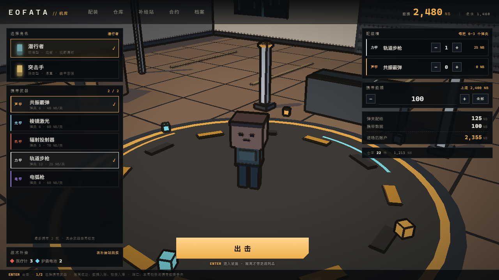
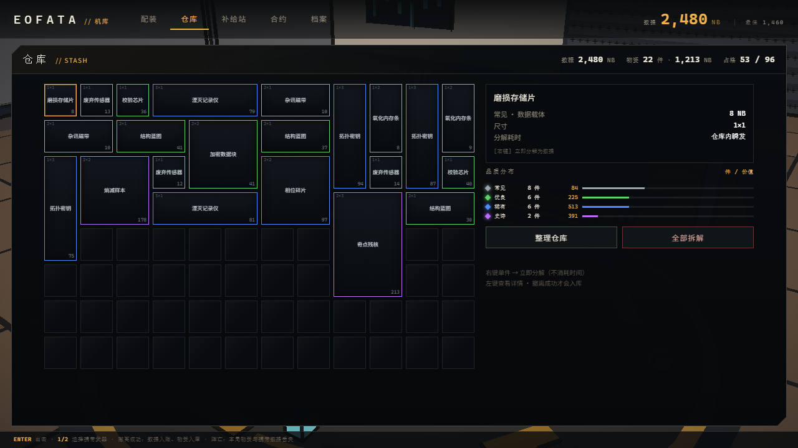
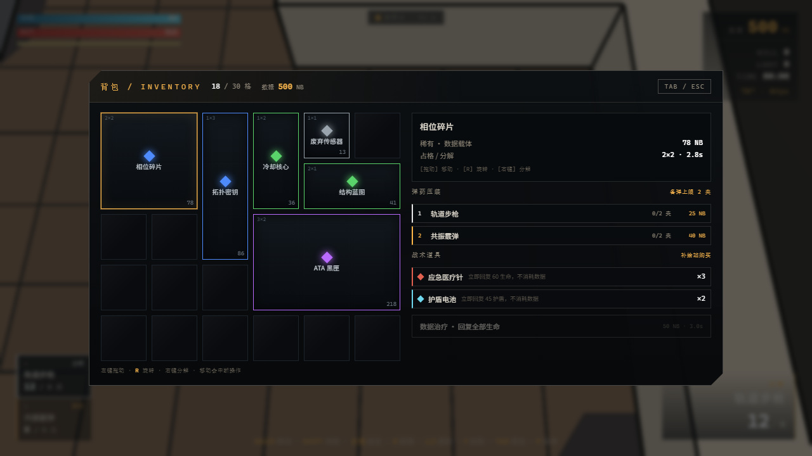
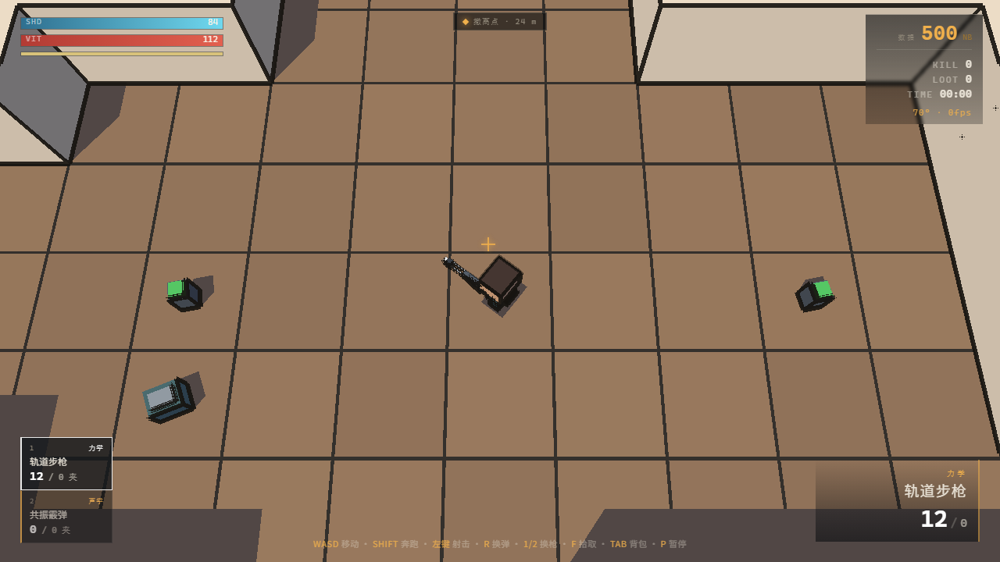

# dev_web3d — 3D 原型

`dev_html/` 是 2D 原型的活化石，这里是从零起的 **3D 版本**：WebGL 手写渲染、方块低多边形、三渲二描边，
美术沿用 `../ART-BIBLE.md` 的低多边形 + 三渲二规范。

当前版本已经把 **大厅 / 配装 / 仓库 / 背包 / 补给站 / 合约 / 档案** 这一整套局外系统接进 3D 原型：
机库里配装出击，设施里搜刮战斗，撤离后数据入账、物资入库，再用数据买补给和永久强化。

### 2026.11.28 开始菜单 / 实体大厅

1. 新增独立黑屏开始菜单：正常加载后先显示 `EOFATA` 标题与「点击开始游戏」，点击按钮 / 画面或按 `Enter` / `Space` 后淡出进入机库。
2. 开始菜单新增「进入大厅」入口：进入一间可自由行走的封闭实体大厅，`WASD` 移动、`Shift` 加速，`ESC` 或右上角「返回机库」按钮直接返回现有机库。
3. 大厅中央留空圆形区域，六个设备环绕摆放并各自独立建模：军械库、打印机、仓库、制造台、联络台、传送台。
4. 靠近设备时底部显示 `F` 互动提示，设备脚下出现高亮环与悬浮标记；按 `F` 目前只显示「功能尚未接入」，预留后续接入实际功能。
5. 实体大厅按游戏内处理：进入时自动请求鼠标锁定，隐藏系统指针；`L` 可切换锁定，浏览器拒绝时点击画面重试，`ESC` / 右上角按钮返回机库。
6. 修正制造台机械臂、联络台天线的局部旋转方向：臂段与末端执行器、天线臂与天线盘现在按各自关节连续旋转，不再出现组件脱节或反向漂移。
7. 移除角色脚下延伸出去的朝向短线（只是定位辅助，容易被误认为模型 bug），保留脚下定位环。
8. 地面投影改为屏幕空间阴影遮罩：墙体 / 设备投影写入阴影缓冲的绿色通道，后处理按地面法线乘暗地板颜色，保留砖缝与地砖纹理；视野遮挡继续使用红色通道，重叠投影只计算一次，不再用纯色三角形直接覆盖地砖。
9. 右下角显示当前构建号；`?skiptitle=1` 可跳过菜单，`?title=1` 可强制显示；`?go`、`?selftest=1`、`?demo=1`、`?auto=1` 等调试入口默认跳过，避免影响截图与自测。`?go=hall` 可直接进入大厅。

### 2026.11.27 清剿小队 / 所有 AI 不再卡门、卡墙

1. **过门引导只在真的要穿门时生效**：旧版只要目标离某扇开着的门超过 1m、单位又在 1.7m 内，就把路点硬改成那扇门的门中心——四个人会围着同一扇门打转。现在先比较「单位到门平面」和「路点到门平面」的符号，只有两侧异号、且穿越点落在门洞宽度内才插入引导点；离得远时先走到门前 1m 的**自己这一侧**中线点，再从正中垂直穿过。
2. **AI 开门改成幂等的「只开不关」**：新增 `World.openDoor()`，`updateEnemyDoor` 只调用它，且用 `door.open`（目标状态）而不是门的动画进度判断。以前用 `toggleDoor`，两名队员在门还没转到位的那几十毫秒里先后点同一扇门会互相抵消，门最后是关的，整队顶着门板推。玩家交互仍然是 `toggleDoor`。
3. **被「不许进屋」挡在门口时放弃目标**：A* 会把路径规划进屋里（门洞可通行），但 `squadBlockedByHouse` 会逐帧取消跨门的位移，旧的实现就一秒一秒重算同一条进屋路径、永远顶在门槛上。现在这种「门禁取消」会计时，超过 0.4 秒就清掉当前目标与最后目击点，换下一个目标。
4. **待命不再往门框上蹭**：队员待命时若压在门洞里，旧版朝「队长那一侧」的法线迈出，队长也在门洞里时方向会变成横的、正好顶住门框；现在按**自己这一侧**的法线迈出，并且只在确实还在门框范围内（|法线距离| < 0.62）时才动。战斗中的「不要站在门洞里对枪」同样改成按自己这一侧退出。
5. **关上的门会把敌人推出去**：`World.resolveDoorTrap()` 以前只对玩家调用，敌人被关门夹住只能靠逃逸搜索慢慢蹭；现在门口附近的敌人也会被推到门外并清掉路径缓存。
6. **队友推挤改为顺位单向让路**：以前两人对称互推各退半步，净位移为 0，狭路里就变成原地抖。现在同一小队里每一对只推**顺位靠后**的那个（队长最优先），方向永远确定；也不再需要「门口禁止互推」（那会让两个人完全重叠、看起来像穿模）。
7. **门框通道收窄**：门洞宽 1.36m、单位半径 0.42m，中心偏出 0.26m 就会穿进门框；旧通道给到 ±0.62m，最多能让半个身子沉进门框里。现在收到 ±0.45m，配合过门引导仍能顺畅通过，但不会肉眼可见地卡在门框里。
8. **走廊里不再贴墙站桩**：两侧都被墙挡住无法走位时，除了站住射击，还会在距离超过 0.8×射程时压上，不会停在射程边缘贴着墙一动不动。
9. **卡住时的恢复换成重新寻路**：位移不足持续 1 秒或 0.7 秒窗口内没有真实前进时，先清掉路径缓存让下一帧重新 A*（侧移时间从 0.9s 缩到 0.55s），不再盲目侧移一整秒。
10. **新增可复现的压测**：`?selftest=1&aistress=1` 会用一张程序生成的测试地图（3 栋带内门的房子 + 一条 2m 窄走廊）跑四段固定步长仿真——中立巡逻、门口进屋、窄走廊穿行、隔门追人——统计「想走但没位移」「卡进几何体」「在门洞里停留」「压在门框里」「同帧重复开关同一扇门」以及各阶段的进屋耗时。常规 `?selftest=1` 也会跑一段短版本作为回归。

### 2026.11.27 地图编辑器

1. 新增独立的 Web 地图编辑器 `editor.html`：2m 网格俯视画布，双击即可打开，零依赖、零构建。
2. **任意正交轮廓房屋**：在网格上画出 L / T / 凹形轮廓，外墙沿轮廓自动生成；内部用内墙工具画隔间，用门工具放外门 / 内门。门仍然支持独立开关、碰撞和视线遮挡。
3. 可摆放 **物资箱 / 武器箱 / 露天物资刷新点 / 敌人刷新点 / 玩家出生点 / 撤离点 / 木箱油桶障碍**；每个刷新点可配置品质倾向、敌人类型 / 数量 / 散开半径 / 阵营，撤离点可调半径与停留时间。
4. 支持 **多撤离点**；局内 HUD、小地图和撤离判定都会自动选择最近的撤离台。
5. 墙体 / 地板笔刷（1×1 / 3×3 / 5×5）、选择拖动、整栋房屋拖动、复制 / 删除、撤销重做、图层开关、实时校验。
6. 地图保存在浏览器 `localStorage`，支持 JSON **导入 / 导出**；保存后点击「试玩」会在新标签页用当前地图直接进入战局。
7. 机库右侧新增 **战局地图** 选择器：保留程序化随机设施，也可选择任意一张自定义地图出击；`?map=<id>&go=mission` 可直接载入。
8. 自定义地图的房屋、箱子、物资、刷怪、出生点和撤离点全部由 `World.loadMap()` 读取；程序化地图、训练场和原有存档流程保持不变。

### 2026.11.27 编辑器 / 敌人 / 撬箱修缮

1. **拾荒者只保留一个编辑类别**：编辑器里的敌人刷新点只显示「拾荒者（随机皮肤）」，游戏生成时在灰鼠 / 暴徒 / 老油条之间随机挑模型；旧地图里的 raider / veteran 会自动归并为拾荒者类别。
2. **自动撬箱需要视野**：物资箱只有在玩家 120° 视锥、24m 内且没有被墙体 / 木箱遮挡时才会自动开始撬开；失去视野或隔墙时撬箱中断。手动 `F` 交互同样不能隔墙进行。
3. **拾荒者搜刮冷却**：每次搜刮会话结束后进入 5–11 秒冷却，期间不再进入拾取逻辑；单次会话超过 18 秒也会强制离开。不可达 / 玩家正在查看的箱子会触发更长冷却。
4. **墙角卡住修复**：拾荒者移动时若实际位移明显小于请求位移并持续约 1 秒，会短暂强制侧移，清掉当前巡逻 / 掩体 / 搜刮目标；追最后目击点时撞墙会立即结束搜索，不再盯着墙角走。
5. **角柱修缮**：自定义房屋只在真正的凸角放置角柱；直线墙缝和凹角不再每 2m 生成一根柱子，消除室内大面积「龙骨」柱列。
6. **非矩形房屋的地板 / 屋顶严格跟随轮廓**：编辑器不会自动把缺口填成墙，非矩形缺口的地形由设计师用墙体 / 地板笔刷决定；需要时可用房屋属性里的「清空轮廓缺口地板」手动处理。擦除工具点击墙体格会把它恢复成地板。地板和屋顶按房屋轮廓拆成尽量少的矩形整体绘制，不再每 2m 出现一格接缝。

### 2026.11.27 敌人互动 / 描边

1. **单位描边按阵营着色**：掩码 G 通道记录单位对玩家的关系，敌对红色、中立黄色、友好绿色；玩家和尸体保持黑色细描边。当前所有敌人默认敌对，预留 `relation = 'neutral' / 'friendly'` 字段。
2. **拾荒者 / 丧尸会开门**：它们靠近关着的安全屋门、正在朝门移动或已贴近门时，会主动打开门，冷却约 0.5–0.8 秒，不区分外门 / 内门。开门是幂等的「只开不关」（`World.openDoor`），不会被后续单位反关。
3. **准星看房掀屋顶**：玩家视线中心（120° 视锥内的头部朝向）在 24m 内命中某栋房屋时，即使站在原 10m 范围外也会隐藏该栋屋顶；视线离开或中间隔墙时恢复。
4. **武器箱描边稳定**：可互动物品的白描边改用单个外包盒写 mask，不再分别写入箱体和箱盖；修复箱体 / 箱盖相交面导致的白色描边闪动。

### 2026.11.27 清剿小队

1. 新增敌人编组 **清剿小队**：战术干员（队长）+ 特种干员 + 侦察队员 + 破障队员，4 人成队出现。地图编辑器敌人类型里新增「清剿小队（4人）」，数量表示小队数；程序化随机设施每局也会生成 1 支。
2. 初始对玩家 **中立**：黄色描边、不会主动攻击玩家，子弹 / 范围伤害也不会误伤玩家。
3. 玩家任意成员造成伤害后，整队立刻变为 **敌对**（红色描边），本局内永久敌对，并把玩家设为共享目标；之后再攻击不会恢复中立。
4. 与僵尸 / 拾荒者 **始终敌对**，三方会互相索敌；清剿小队之间同阵营不互斗。
5. **AI 联动**：任一成员发现目标时共享给全队，队员优先集火同一目标；队员始终围绕队长移动，离队超过 6m 会先归队。
6. **不搜刮、长期游荡**：清剿小队不参与物资点 / 箱子搜刮；出生自带 3 件以上稀有 / 史诗物资和芯片（可能额外携带一把武器），死亡后直接掉落。队长会在地图上不断选择较远的室外游荡点，队员跟随整队移动。
7. **不主动进入未侦察建筑**：游荡目标、追最后目击点和队形点都会避开没有观测到敌人的房屋；门口移动也会被拦住，只有某名成员实际看到屋内敌人（或玩家从屋内攻击）后，该房屋在 30 秒内才会被视为可进入，门也才会被打开。
8. 武器配置：队长固定力学 · 轨道步枪；其余三人从声学 / 光学 / 热学 / 电学里随机分配 3 种不同武器，因此五种武器类型都可能出现。AI 会按武器模态开火：声波锥形、激光光束、热学燃烧区、电弧链、实弹。
9. 清剿小队成员可被击杀并留下可搜刮尸体，尸体武器按成员实际武器掉落。
10. **寻路 / 性能**：所有 AI 单位（丧尸 / 喷吐者 / 干尸 / 拾荒者 / 清剿小队）共用 2m 网格 A* 绕墙；近距离或视线直达时直接移动，只有被墙隔开才寻路。路径按单位缓存，每帧最多重算 3 条，清剿小队额外带房屋禁入格。A* 使用预计算的房屋墙体边表，门洞可通行、墙体不可穿过；房屋查询改为格子索引 O(1)，屋顶准星判定改为第一次墙体命中，不再每帧遍历所有房屋采样；阴影只处理视野附近房屋。实测自定义地图 84 敌人时 update 平均约 2ms、P95 约 3.4ms。
11. **生命 / 护盾增强**：普通队员 150 生命 + 70 护盾，队长 180 生命 + 100 护盾；护盾优先吸收伤害，脱战 5 秒后按 18/s 自动充能。护盾伤害显示为蓝色数字。
12. **尸体清理**：尸体上的物品、两把武器槽全部被拿空后，界面自动关闭，尸体与普通僵尸一样下沉淡出并移除。

### 2026.11.27 分解锁定与尸体清理

1. **分解锁定**：物品开始分解后锁定在当前容器（背包 / 物资箱 / 尸体）内，分解期间不能拖动、旋转、装备、存入 / 取出、丢弃或一键转移；一键拿取 / 存入会跳过正在分解的物品。
2. **尸体清理**：尸体容器被搜空后自动关闭界面，尸体模型下沉消失，容器从世界中移除。

### 2026.11.27 自定义地图终点掉帧修复

1. **屋顶显隐采样优化**：网格房屋不再遍历每格 5 个屋内采样点（大型房屋会放大到上千次墙体射线），改为只沿实际打开的门的门洞取样。
2. **视线检测去重**：屋顶显隐只检测墙 / 门，不再重复执行两遍房屋墙体检测，也不受木箱等可绕开的道具影响。
3. **结果缓存**：玩家原地不动且门开 / 关状态不变时直接复用屋顶显隐结果；移动超过 0.45m 或门状态变化才重新采样，避免每帧 7ms 级开销。
4. 用 `?map=...&go=mission` 复现自定义地图终点：修复前该位置 `updateHouses` 约 7.3ms/帧，修复后站桩约 0.1ms/帧；高分辨率压力场景帧率提升约 1.5–2 倍。

### 2026.11.27 全面性能优化与 AI 逻辑修复

1. **A* / 房屋墙体**：新增预计算房屋墙体边表，A* 不再从墙格边穿过去；门洞仍然可通行。A* 复用全地图 typed array 缓冲区，减少长局 GC。
2. **空间查询**：房屋碰撞 / 射线检测先做 AABB 包围盒剔除；`sightBlocked` 不再重复跑第二遍房屋墙检测；AI 感知先做便宜的视野锥判断，再跑 LOS。
3. **可见性节流**：敌人视野约 14Hz、地面收集物约 10Hz 更新；已拾取收集物定期清理；小地图降到 20Hz。
4. **渲染 LOD**：物资箱 10m 内 / 武器箱 18m 内使用完整 OBJ，更远用低模盒，30m 外剔除；箱盖完整网格只保留 6m 内；远处尸体、房屋门 / 屋顶也做距离剔除。
5. **GL**：动态几何上传复用 Float32Array 容量；box 面索引预展开，减少每帧临时数组分配。
6. **AI 逻辑**：清剿小队采用**队长单点决策 + 队员直接跟随**：队长按 2.2–4s 冷却选择下一个游荡目标，不考虑队员位置；**游荡点限制在 6–20m 内并用 A* 验证可达**，走不到的目标不会选中。巡逻目标 1.2 秒没有进展会立即放弃并换点，`stepTo` 也不再把手被墙挡住当成“已到达”，避免整队站着空转。队员各自用 A* 直接追队长当前位置，不再复制队长路线，并按队内序号保持 1.9 / 2.7 / 3.5m 的跟随距离与 1m 迟滞。**接近开着的门且目标在门另一侧时，会先走到门洞中心再穿过**；AI 在开着的门洞中心线附近有一条无墙体碰撞的通道，门框不会再刮住单位；如果单位已经被挤进墙体 / 门框，`moveCircle` 会先搜索最近的可站立点把自己推出来。**队员不会停在门洞里**：待命时若正好站在门口会先朝队长一侧迈出去，战斗中也不会站在门洞里对枪，而是先沿门法线离开门洞。**交战中（看到目标、追击最后目击点、被其他阵营攻击）允许进入任何房屋**，不会因为没有房屋情报站在门口抗拒进入；游荡时仍避开未侦察房屋。小队成员在门口附近（1.15m 内）关闭互相推挤，多人可以同时通过门洞而不会互相顶死，离开门口后恢复推挤避免叠人。**没有可用路径且直线被墙挡住时不再朝墙硬推**，先原地等待下一次寻路；战斗侧移会先探测两侧，贴墙时换向，两侧都被墙挡住就站住射击，不再沿墙蹭。`findPath` 目标格落在墙 / 门框时自动回退到最近可行走格；新增 0.7s 真实位移窗口检测，被门框回弹抵消的单帧抖动也会被识别并向可通行方向强制侧移脱困。队长阵亡后自动推举存活成员；共享目标会重置队员丢失计时并锁定集火；情报过期后可从屋内开门撤离；小队出生点避开未侦察房屋；拾荒者只搜刮已撬开的箱子并在吸取前重新校验视线；直接伤害武器 / 燃烧区 / 电弧链都增加最终 LOS 校验，不能隔墙命中；喷吐弹使用实际阵营；护盾充能延迟在破盾后继续受击时也会刷新；尸体和战利品标记不再穿墙渲染。

7. **NPC 射击**：所有持枪单位（清剿小队、拾荒者等）统一走实体子弹逻辑，不再出现“看到即命中”的直接伤害。声学 / 光学 / 热学 / 电学 / 力学武器都会发射带对应颜色和弹体外观的子弹，必须实际飞到目标才会命中；敌方的热学子弹命中墙 / 地面不再生成玩家阵营燃烧区。

### 2026.11.27 丢出物品

1. **操作方式**：物品详情新增「丢出」按钮；也可以把背包物品直接拖出背包面板丢到地上。装备中的武器卡片新增「丢出」按钮，并可拖出面板丢出。
2. **投掷落点**：朝当前准星地面落点抛出，最远约 6.5m，带短抛物线和落地动画；落点被墙 / 道具占用时沿投掷线回退，最终退回脚边。
3. **非武器收集物**：材料 / 芯片等以现有地面收集物外观落地（物资箱 / 罐子），保留品质色和物品数据。
4. **武器建模**：武器使用自身 3D 建模躺在地上，可重新拾取；完整保留弹夹、备弹和已安装芯片。
5. **装备武器**：丢出当前装备武器后对应武器槽清空，自动切换到剩余武器；没有剩余武器则变为空手。

### 2026.11.27 角色建模扩充（Blender MCP）

1. 用 Blender MCP 重建全部方块角色几何：`assets/chars/build_characters.py` 读取基准方块、统一修缮后导出 `js/charmodels.js`，`models.js` 优先使用 Blender 导出的数据。
2. 所有人物**去掉全部手臂、肩甲以及身体两侧的凸出部件**：角色只保留躯干、头部、腿、背包与前胸装备。
3. 新增 3 名科幻战术队员：**幽影**（长条青色目镜 + 夜战装甲）、**游隼**（琥珀条镜 + 轻型护甲）、**铁砧**（重型胸甲 + 破障背包）。
4. 新增 3 套动力装甲：**铁壁**（反应堆背包 + 排气烟囱）、**先锋**（白色装甲 + 推进喷口）、**哨戒**（长条琥珀目镜 + 警戒涂装）。
5. 新角色全部加入机库选择、可被玩家操控；共用 Blender 导出的 `walk / sprint / reload` 动作，并按装甲重量单独调整步频、摆腿、起伏与前倾。
6. 三组模型预览图保存在 `assets/chars/preview_existing.png`、`preview_tactical.png`、`preview_power.png`。
7. 修正骨骼绑定：按部件语义区分头 / 躯干 / 腿，动力甲胸灯带、背包排气、战术队员电台天线不再绑到头部；靴子、护膝、护胫绑定到对应腿，并统一以髋关节为转轴摆动。可用 `tools/bone_preview.html?key=juggernaut&pose=walk&view=side&t=0.24` 检查腿部和绑定。

### 2026.11.27 元素系统

1. 新增五系元素：**声学 / 光学 / 热学 / 力学 / 电学**，和武器系列、专属芯片共用同一套名称与配色。
2. 所有战利品固定带元素属性；同一件物资可以带 1–2 种元素，数值与品质表固定，不随机。
3. **局内分解只给数据（NB）**；**仓库分解给数据 + 元素**；撤离时仓库满导致的自动分解也会回收元素。
4. 系列专属芯片带对应元素，通用芯片不带；枪械固定带自己系列的元素。制造出来的武器 / 芯片**完全不带元素**。
5. 制造武器和系列专属芯片需要消耗对应元素，并保留原有 NB 造价；通用芯片只消耗 NB。
6. 元素作为独立的仓库资源保存，不占仓库格、不进背包、不影响局内战斗；局内也会显示元素价值，但局内分解仍只回收数据。
7. 仓库新增元素库存栏；仓库网格 / 手机列表 / 详情页显示元素，制造工坊显示元素库存与配方消耗。
8. 新档初始元素库存为五系各 **1000**；演示档同样按此数量初始化。
9. 旧存档自动补齐旧物资、旧芯片、旧武器的元素；没有元素库存的旧档补发一次初始 1000；存档版本升级到 8。
10. 局内背包 / 物资箱 / 尸体界面的物品格显示元素色点与数值，详情和悬停提示显示完整元素属性；右键分解时，**分解进度条显示在目标物品下方**。
11. 拖拽系统全面修缮：物资箱 / 尸体物品可自由拖到背包、武器栏、尸体武器槽；武器箱 / 尸体武器槽里的武器可直接拖到武器栏装备，不必先放进背包；搜索过程中已发现的物品可以继续移动、拿取、装备，搜索队列会自动跳过已被提前拿走的物品。
12. 修复同型号双持武器的芯片串用：芯片改为存放在**具体武器物品**上，机库配装槽和局内武器槽都按各自武器独立计算芯片、改修与 HUD 指示；拖到其中一把不会影响另一把。
13. 拾荒者搜刮改为**物资点吸取**：不再撬箱、不再逐件交互。到达地面物资 / 物资箱旁后先待机 **0.6s**，之后每 **0.45s** 吸取一件，单次最多 **3 件**，剩余物资留给玩家或其他单位；不可达 / 卡住目标 1.5s 后放弃，玩家正在查看的箱子直接跳过，并按实际物品尺寸判断背包空间。
14. 与 UI 交互时锁定视角：打开物资箱 / 背包 / 尸体界面后，鼠标只驱动界面指针，不再转动角色；关闭界面后保持原朝向，移动鼠标才恢复瞄准（训练场配装台同样生效）。

#### 固定元素表

| 品质 | 物资 | 固定元素 |
| --- | --- | --- |
| 常见 | 磨损存储片 | 光学 3 |
| 常见 | 氧化内存条 | 电学 4 |
| 常见 | 杂讯磁带 | 声学 5 |
| 常见 | 废弃传感器 | 光学 2 · 力学 2 |
| 优良 | 加密数据块 | 光学 6 · 电学 3 |
| 优良 | 校验芯片 | 光学 6 |
| 优良 | 冷却核心 | 热学 8 |
| 优良 | 结构蓝图 | 力学 7 |
| 稀有 | 相位碎片 | 光学 9 · 电学 6 |
| 稀有 | 拓扑密钥 | 力学 10 · 光学 5 |
| 稀有 | 湮灭记录仪 | 热学 11 · 声学 5 |
| 史诗 | 奇点残核 | 电学 16 · 力学 12 |
| 史诗 | ATA 黑匣 | 光学 16 · 声学 10 |
| 史诗 | 熵减样本 | 热学 18 · 光学 10 |

| 枪械 | 固定元素 / 制造消耗 |
| --- | --- |
| 共振霰弹 | 声学 70 |
| 棱镜激光 | 光学 80 |
| 辐射投射器 | 热学 75 |
| 轨道步枪 | 力学 50 |
| 电弧枪 | 电学 90 |

| 系列专属芯片 | 固定元素 / 制造消耗 |
| --- | --- |
| 声学共振芯片 | 声学 20 |
| 光学棱镜芯片 | 光学 22 |
| 热学扩散芯片 | 热学 21 |
| 力学穿甲芯片 | 力学 28 |
| 电学导流芯片 | 电学 30 |

> 以上数值即制造配方消耗；制造出的成品不携带这些元素，不能通过“制造 → 分解”回收元素。

### 2026.11.27 屏幕外敌人头像

1. **小地图可见、3D 画面没拍到**的敌人会在屏幕边缘对应方向显示头像标识 + 三角形方向指示。
2. 头像由现有方块敌人的**头部模型正面投影**生成（保留配色、发光件和墨线），不新增图片素材。
3. 头像尺寸随敌人与玩家的**距离**变化：越近越大、越远越小。
4. 全部符合条件的敌人都会显示，允许重叠；暂停、背包、训练配装、结算时自动隐藏。

### 2026.11.26 动作模组（Blender MCP）

1. 人物走动时头部按 Blender 曲线**左右摇头 + 点头 + 轻微侧晃**，频率约为每两步一次；停下后平滑过渡到很轻的待机摇晃，不再瞬间静止。
2. 奔跑时**枪横在胸前**，身体锁定移动方向；头部**不锁定范围**，可以随鼠标 / 右摇杆自由转向；头部转向有角速度上限和缓动。
3. 奔跑中**禁用射击**，屏幕提示「奔跑中无法射击」；`R` 会先停下奔跑再换弹。
4. 新增**换弹动画**：枪身先横到胸前，再侧倾下压、旧弹夹掉落、新弹夹推入；玩家与拾荒者枪手共用同一套曲线。
5. 敌人同步获得新动作：所有敌人在移动时头部摇动；拾荒者枪手在巡逻 / 搜索 / 转移掩体时横枪奔跑，换弹时播放换弹动画。
6. 奔跑时**身体和枪械同步左右摆动**；枪械随步伐上下颠动并带轻微俯仰 / 横向晃动；枪械使用整体刚体变换，W / S / A / D / 斜向奔跑都不会散架或插进身体。
7. 进入 / 离开奔跑、开始 / 结束换弹时，枪从正常持枪到横胸持枪之间使用**快速缓动**，不会瞬移到位。
8. 走路也有轻微身体左右反应，奔跑反应更明显；跑走切换与停下时通过混合权重过渡。
9. 玩家视野限制为 **120° 视锥**（左右各 60°），视锥跟随头部朝向；视锥外的敌人、地面收集物和小地图标记隐藏，地面压暗；**视锥边界为硬边**。
10. 修复快速转头 + 奔跑转向时视锥角度回绕错误造成的“伪全向视野”；视野显示与实际 120° 可见范围现在一致。
11. 奔跑转向加入缓动：移动朝向 `moveYaw` 以约 7/s 的速度追向输入方向，腿和身体一起平滑转向，不会瞬间拧到新方向。
12. 奔跑时头部保持自由转向，不锁定到身体；快速甩鼠标时通过角速度上限 + 缓动平滑扫过，不会瞬间甩到另一侧。
13. 用 Blender MCP 建立同比例方块角色和 `walk / sprint / reload` 动作，导出 `js/animdata.js`；参考工程保存在 `assets/anim/eofata_actions.blend`。

打开方式：直接双击 `index.html`（没有构建、没有依赖、没有网络请求）。
地图编辑器直接双击 `editor.html`；如果浏览器限制本地文件 / 试玩无法共享 localStorage，就在本目录起个静态服务：

```powershell
cd dev_web3d
npx serve .        # 或任意静态服务器
```

> 更新后如果页面表现没变，先 `Ctrl+F5` 强制刷新。`file://` 直开时浏览器可能缓存旧的 `js/*.js`，
> 最稳妥的是用静态服务打开（脚本版本号见 `window.__build`，控制台会打印 `EOFATA build ...`）。

## 预览

| 机库 / 配装 | 仓库 | 局内背包 |
| --- | --- | --- |
|  |  |  |



---

## 已实现

| 模块 | 状态 |
| --- | --- |
| WebGL 渲染器 | 零依赖手写：两段色阶 + 屏幕空间场景描边 + 人物细描边 + 投影平涂阴影 |
| 相机 | 透视 44°，默认 **70°**，可按 `[` `]` 切 55/62/70/80/90，滚轮拉近拉远 |
| **视野** | 玩家 **120° / 24m 视锥**（左右各 60°，跟随头部朝向）；视锥内且**没有被墙体/木箱/设备遮挡**的敌人才会显示，视锥外、被遮挡或超距的敌人 3D 和小地图都不显示（AI 照常行动）；**地面收集物**同样只在视野亮区绘制 3D 和小地图标记，物资箱 / 武器箱不受此限制；地面阴影按视线直接生成**锐利直线边缘**的阴影多边形，视锥边界为**硬边**，墙体/物体不受影响，物资箱不遮挡视野 |
| 地图 | 程序化设施：9 个房间 + L 形走廊，2m 网格，88×88m，26 个物资点；也可由 `editor.html` 设计自定义地图并在机库选择出击 |
| **地图编辑器** | 独立 Web UI：2m 网格、任意正交轮廓房屋、内墙 / 内外门、物资箱 / 武器箱 / 露天物资 / 敌人刷怪 / 玩家出生 / 多撤离点 / 障碍物；撤销重做、图层、校验、JSON 导入导出、一键试玩 |
| 玩家 | 方块人（1 方块头 / 1 方块身 / 2 方块腿），WASD 移动，枪械朝向随鼠标移动；可选潜行者 / 突击手 / 战术干员 / 拾荒者（灰鼠、暴徒、老油条）/ 特种干员 / 侦察队员 / 破障队员 / 动力甲（铁壁、先锋、哨戒）；**走路摇头晃脑、奔跑横枪 + 自由转头、换弹横枪动画、120° 视野** |
| 武器 | 五把，各自一套模态；枪口火光、命中火花、无准星（枪口即瞄准方向）、命中标记，**不出抛壳**；同型号武器可双持，每把的弹夹/备弹/芯片独立；武器物品复制保留 `mag`/`spares`/`chips` |
| **武器芯片** | 每把 3 槽；通用芯片 + 五系专属芯片（声学 / 光学 / 热学 / 力学 / 电学），1×1，每种芯片固定品质；机库与局内均可装卸；芯片直接存放在具体武器实例上，**同型号双持时两把武器互不共享芯片**；芯片可直接拖到武器卡任意位置自动进入第一个空槽；机库仓库可直接拖到配装武器卡安装，也可从武器卡拖出卸下；普通局物资箱 / 武器箱有概率刷出 |
| **元素系统** | 五系元素（声学 / 光学 / 热学 / 力学 / 电学）；新档初始各 1000；战利品固定元素表；局内分解只给数据，仓库分解给数据 + 元素；专属芯片和枪械带对应元素；元素作为仓库资源数值保存，局外和局内都显示；制造武器 / 专属芯片消耗元素 + NB，成品不带元素；旧档自动补齐 |
| **制造工坊** | 用数据制造五把武器和全部芯片；武器 3×1 进仓库，芯片 1×1；分解可回收数据价值 |
| 敌人 AI | 每局 **26 只**丧尸/喷吐者 + **9 名拾荒者枪手**混编；枪手默认力学「轨道步枪」，3–5 连发、0.5 秒反应、走位与基础掩体；**拾荒者与丧尸互为敌对阵营**，会互相攻击；**木箱、设备会遮挡枪手视线，物资箱不挡**；枪手会先撬开箱子再搜刮，背包满或物品放不下时停止并换目标；死亡后播放碎裂动画并留下**无碰撞**的可搜刮尸体，**尸体上的枪保留敌人当前弹夹余弹**；尸体界面为 **2 个武器槽 + 4×3 物资格**，支持武器/物资双向拖拽、拖拽图像保持和装备动效；所有敌人移动时头部摇动，枪手在巡逻 / 搜索 / 转移掩体时横枪奔跑，换弹时播放换弹动画；**到达物资点待机 0.6s 后每 0.45s 吸取一件，单次最多 3 件，卡住 1.5s 后放弃目标** |
| **碰撞** | 玩家/敌人/子弹对木箱、设备使用**旋转矩形碰撞**，与方形模型一致；玩家/敌人对物资箱/武器箱也使用旋转矩形碰撞，子弹仍可穿过箱子 |
| **战斗交互** | F 搜索已撬开的物资箱、拾取地面物资、R 换弹、撤离台计时、死亡/撤离结算；120° 视锥内、24m 内被墙挡住的收集物/物资箱/武器箱显示橙色纯色轮廓 |
| **机库大厅** | 3D 机库 + 悬浮全息环；角色可拖动旋转检视，主界面显示当前配装摘要 |
| **仓库** | 12×8 大网格、武器 3×1 收集物、两把武器配装槽（武器可拖拽装备/卸下）、弹夹/携带数据、跨局保存、分解、整理、品质分布 |
| **局内背包** | 6×N 网格、拖拽 / R 旋转 / 右键读条分解（进度条显示在目标物品下方）、压装弹夹、数据治疗；物品格 / 详情显示元素价值；武器可从背包、物资箱、尸体武器槽直接装备或替换 |
| **战术道具** | **Q / E** 两个配置槽、最多携带两种；全部默认解锁；使用消耗局内数据并进入冷却；飞刀 / 手榴弹 / 辐射场；HUD 显示冷却与数据不足；辐射场持续伤害会弹跳字 |
| **鼠标锁定** | 进入战局自动请求 Pointer Lock，真实指针固定在窗口中心；失败时点击画面或按 `L` 重试；打开 UI 时解除，关闭 UI 后重新锁定 |
| **内置鼠标** | 游戏内箭头指针；只在背包 / 暂停 / 结算 / 训练配装台等 UI 状态显示，射击时不显示；与 `L` 鼠标锁定兼容 |
| **补给站** | 战术道具信息与 4 类永久强化（护盾 / 生命 / 背包 / 装填） |
| **合约** | 3 个并行合约，单局类 + 累计类，领取数据奖励，全部完成后刷新 |
| **档案** | 出击/撤离/击杀/拾取/分解/最佳带出统计、强化概览、最近 12 局战绩、清档 |
| **手机双摇杆** | 横屏锁定、双同心圆无摇杆头、左移动（走 / 跑 / 圈外松手持续移动）、右射击（瞄准 / 开火 / 锁定）、触屏动作键、移动端大厅与仓库 |
| **物资箱** | Blender 导出的低模箱体；靠近自动撬箱约 1.6s，箱盖随机飞走后按 `F` 进入逐格搜索（放大镜/爆闪揭示）；**搜索中已发现的物品就可以移动 / 拿取 / 装备**，并支持箱子 ↔ 背包、箱子 → 武器栏、尸体背包 ↔ 尸体武器槽的自由拖拽 |
| **武器箱** | 独立 Blender 低模武器箱；3×2 格，每局 2 个，只出武器与芯片 |
| **训练场安全屋** | Blender 制作的 **2m 模块化**组件（实心墙 / 窗墙 / 门墙 / 门 / 角柱 / 地板 / 2×2m 屋顶瓦片 / 屋顶空调）在游戏里拼装；**无房檐**，屋顶瓦片边缘不超出外墙。每边 2–12 个模块，门可放在任意外墙模块位并支持多扇；支持 **室内隔断 / 多房间** 和独立内门。每扇门独立 `F` 开关；关门阻挡移动 / 子弹 / 视线。任意一扇门开着且 10m 内能看到屋内（或玩家在屋内）时整栋屋顶**瞬间隐藏**。训练场摆了 6×4m、8×6m、12×10m 三栋多房间示例房，不进入随机主地图 |
| **移动碰撞** | 玩家/敌人碰到墙体或圆形障碍时沿切向平滑滑动，不硬停；圆形障碍优先切线、墙体优先单轴滑动，墙角再尝试角度偏转；安全屋门关闭时若玩家在门洞里会被自动推出 |
| **屏幕外敌人** | 小地图可见但 3D 相机没拍到的敌人，在屏幕边缘对应方向显示**头部头像 + 方向三角**；头像由现有方块模型正面投影生成，尺寸随距离近大远小；全部显示、允许重叠 |
| **小地图** | 北向上本地雷达：地板 / 墙体 / 道具 / 视野内物资 / 敌人 / 撤离点；撤离点与刷新点超出范围时贴边指向 |
| **存档** | `localStorage`：账户、仓库、补给、强化、合约、战绩、配装、设置 |

---

## 调试参数

| 参数 | 作用 |
| --- | --- |
| `?pitch=45` | 指定任务镜头俯角（30–85） |
| `?dist=10` | 指定任务镜头距离 |
| `?demo=1` | 填一套展示用存档（数据、仓库、强化、战绩） |
| `?tab=stash` | 启动后直接打开大厅内页：`loadout / stash / craft / shop / contracts / archive` |
| `?map=<id>` | 指定自定义地图（地图编辑器保存的 id）；可配合 `?go=mission` 直接试玩 |
| `?dpr=1` | 限制 WebGL 内部渲染倍率（高 DPI 屏掉帧时可降到 1 / 1.25） |
| `?go=mission` | 跳过点击，直接带默认配装出击 |
| `?go=hall` | 跳过菜单，直接进入实体大厅 |
| `?skiptitle=1` | 跳过开始菜单 |
| `?title=1` | 强制显示开始菜单（调试截图用） |
| `?go=inventory` | 出击后立刻打开背包，并塞入 6 件样品 |
| `?go=end` | 出击后直接走一次撤离结算 |
| `?go=death` | 出击后直接走一次阵亡结算 |
| `?safe=1` | 配合 `?go=` 清空敌人，方便截图 |
| `?selftest=1` | 运行内置自测（账户/仓库/背包/拖拽/分解/撤离/合约/存档 + 清剿小队卡门压测），结果写到页面左上与 `document.title` |
| `?selftest=1&aistress=1` | 只跑 AI 卡门 / 卡墙压测（可用 `rounds / roamT / fightT / corridorT / kiteT` 调规模），详细数据打印到控制台 |
| `?go=test` | 直接进入训练配装测试场（等同大厅底部「进入测试场 · 训练配装」按钮） |
| `?auto=1` | 自动开火（调试武器手感） |
| `?touch=1` | 强制显示触屏双摇杆 / 手机 HUD（桌面预览用） |
| `?touch=0` | 强制关闭触屏 UI（触屏设备也可用） |

---

## 局外循环

```
机库（配装 / 仓库 / 补给 / 合约）
  → 支付数据（弹夹 + 携带数据）
  → 进入设施：搜刮物资、交火、TAB 分解/压装/治疗
  → 站入撤离台 6 秒
      ├─ 成功：剩余数据入账，背包物资转入仓库，合约进度结算
      └─ 阵亡/放弃：本局物资、未花完的数据、未使用的补给全部丢失
  → 回机库：仓库拆解、补给站消费、领取合约奖励、强化
```

**风险收益**：带得越多、搜得越贪，越可能连人带物资一起丢；撤离才结算。

---

## 武器测试场

从大厅底部 **「进入测试场 · 训练配装」** 进入，或直接访问 `?go=test`。这是一张 48×48m 的开放测试场地，**不消耗账户数据，拾取与数据也不会入账**。

- **无限体力**：测试场内奔跑不消耗耐力，方便连续走位和测试。
- **数据无限**：训练场数据显示为 `∞`，压装弹夹、数据治疗、道具消耗都不会耗尽。
- **初始空手**：训练场开局不携带任何武器和战术道具。
- **训练配装台**：出生点东侧的青色台座，靠近按 `F` 打开配装界面；可选择 **最多 2 把武器 + 2 个战术道具**，切换后立刻生效。武器自动配满弹夹 + 9 个备弹，道具在训练场**没有冷却**。
- **固定靶**：三组高血量靶子，不移动、不攻击，用于观察弹道和范围特效：
  - **两墙之间**（东侧走廊）：6 个靶，测试光学 / 激光。
  - **扇形**（西侧）：9 个靶呈扇面排开，测试声学锥形冲击。
  - **圆圈**（北侧）：8 个靶绕成一圈，测试热学范围。
- **刷新点**：西侧蓝色台座，站定 **1 秒**刷新全部靶子；需先离开再回来才能再次刷新。
- **撤离点**：东侧琥珀色台座，站定 **2 秒**结束测试并返回机库。
- **随机物资**：场内散落 12 件随机品质物资，可拾取、分解、压装弹夹，用于测试背包流程。
- **物资箱**：场内固定 4 个可开启箱子，每个 4×4 格、6 件物资；靠近自动撬开约 1.6 秒，箱盖飞走后按 `F` 进入逐格搜索界面，搜索完成后可拖拽/点击双向转移。开箱与开背包都**不暂停、不减速**。
- **安全屋（模块化 / 多房间）**：训练场生成三栋示例房：
  - 小：3×2 模块 = **6×4m**，横向隔断，**2 个房间**，1 扇外门 + 1 扇内门；
  - 中：4×3 模块 = **8×6m**，纵向隔断，**2 个房间**，2 扇外门 + 1 扇内门；
  - 大：6×5 模块 = **12×10m**，纵向 + 横向隔断，**3 个房间**，3 扇外门 + 2 扇内门。

  房屋由 Blender 模块拼装：实心墙 / 窗墙 / 门墙、门、角柱、2×2m 地板、2×2m 屋顶瓦片和可选屋顶空调。**没有房檐**：屋顶瓦片缩到略小于 2m，边缘与外墙齐平、不向外挑出；角柱也向内收，柱身和底座不超出外墙。每边可配置 **2–12 个模块**；门占一个完整 2m 模块并居中，门宽 1.36m，可在任意外墙模块位放多扇门，同一模块最多一扇。每扇门（包括内门）独立 `F` 开关、独立碰撞和视线遮挡。

  外门配置写成 `{ side: 'front' | 'back' | 'left' | 'right', index }`。`front / back` 的 `index` 从左侧开始数，`left / right` 的 `index` 从前侧开始数。室内隔断写成 `{ axis: 'x' | 'z', line, from, to, doors: [index...] }`：
  - `axis: 'x'`：沿 X 方向的墙，位于局部 `z = line`；
  - `axis: 'z'`：沿 Z 方向的墙，位于局部 `x = line`；
  - `from / to`：墙段两端的局部坐标（按 2m 网格）；
  - `doors`：从 `from` 端开始数的模块索引。

  运行时可这样生成任意尺寸 / 多门 / 多房间：
  ```js
  houses.push(makeHouse(23, 35, 0, 4, 3,
    [{ side: 'front', index: 2 }, { side: 'right', index: 1 }],
    'custom',
    [{ axis: 'z', line: 0, from: -3, to: 3, doors: [1] }]
  ));
  ```

  屋顶没有碰撞，仍整栋统一显隐：任意一扇门开启（>35%）、玩家距该房屋外轮廓 ≤ **10m**，并且玩家在屋内或从玩家位置能透过任意开着的门看到屋内采样点时，整栋屋顶**瞬间消失**；关门、离开 10m 或失去屋内视线后立即恢复。内墙和内门会挡住视线，所以从外门只能看到它所在房间；只要任意一个房间可见，整栋屋顶就隐藏。

  外墙和内墙都参与移动、子弹和视线遮挡；模块化墙体、地板和角柱进静态遮挡层，门和可见屋顶进动态场景层，所以玩家被墙体或屋顶挡住时也会显示橙色纯色填充。

范围一律用视觉特效表达（火焰、碎片波面、光束、电弧），**不画地面范围线**；但战术道具的**长按瞄准预览**例外：飞刀显示直线、手榴弹/辐射场显示圆形范围。特效本身也保持固定朝向，不绕中心旋转。

---

## 地图编辑器

打开 `editor.html`。编辑器是一张 2m 网格的俯视画布，所有坐标直接对应游戏世界（1 格 = 2m）。

### 工具

| 工具 | 键 | 说明 |
| --- | --- | --- |
| 选择 | `V` | 点选物体 / 房屋；拖动移动；`Delete` 删除；`Ctrl+D` 复制 |
| 平移 | 空格 / 中键 | 任意工具下按住空格或中键拖动 |
| 地板 | `G` | 画可通行地板；笔刷 1×1 / 3×3 / 5×5 |
| 墙体 | `X` | 画实心墙 / 空地；覆盖房屋格会把它从房屋移除 |
| 房屋 | `H` | 拖拽画任意 L / T / 凹形轮廓；相邻格并入当前房屋，`Esc` 结束当前房屋 |
| 内墙 | `P` | 在同一栋房屋的相邻格之间画隔墙；右键擦除 |
| 门 | `D` | 点外墙放外门，点内墙切换内门；右键移除 |
| 物资箱 / 武器箱 | `1` / `2` | 放置可开启箱子 |
| 露天物资 | `3` | 放置露天物资刷新点；可调品质倾向 |
| 敌人 | `4` | 放置刷怪点；可调类型、数量、散开半径、阵营 |
| 玩家出生 | `5` | 放置玩家出生点与朝向 |
| 撤离点 | `6` | 放置撤离点；可调半径、停留时间，可放多个 |
| 障碍物 | `7` | 放置木箱 / 油桶，参与碰撞、子弹和 AI 视线遮挡 |
| 擦除 | `E` | 删除物体、门、内墙或房屋格；点击墙体格会把它恢复成地板 |

### 保存与试玩

- 编辑内容会自动保存到浏览器 `localStorage`（`eofata3d.maps.v1`），也可以手动「保存」。
- 「导出」下载 JSON；「导入」读取 JSON 并追加到本地地图库。
- 「试玩」保存当前地图后打开 `index.html?map=<id>&go=mission`，直接进入 3D 战局。
- 机库右侧「战局地图」可以选择随机设施或任意自定义地图出击；小地图、多撤离点和 AI 刷怪都会自动适配。

### 房屋数据格式

编辑器内部把房屋存成格子轮廓；运行时 `World.loadMap()` 会把它转成和模块化安全屋相同的 `h.walls / h.doors / h.modules` 结构，因此碰撞、门、屋顶显隐、小地图和渲染完全复用现有逻辑：

```js
{
  cells: [[6,6],[7,6],[8,6]],       // 2m 格子坐标
  doors: [{ cx: 7, cz: 6, dir: 'front' }],  // 外墙门（dir 指向屋外）
  partitions: [{ cx: 7, cz: 6, dir: 'right', door: true }] // 内墙 / 内门
}
```

`dir` 为 `front / right / back / left`；内墙使用相邻两格中坐标较小的一格，并统一写成 `front / right`。

---

## 机库 / 配装

- 启动后进入 **3D 机库**：镜头缓慢环绕出击平台，背景是卷帘门、控制台、储物架和货箱。
- **角色**：潜行者 / 突击手 / 战术干员 / 拾荒者（灰鼠、暴徒、老油条）/ 特种干员 · 幽影 / 侦察队员 · 游隼 / 破障队员 · 铁砧 / 动力甲（铁壁、先锋、哨戒），只影响外观（模型）与步态轻重，数值一致；选择跨局保存。
- **武器**：从 5 把里选 **2 把**，其余当局锁死；局内用 `1` / `2` 切换。
- **初始弹夹**：每把可配 **0–3 个**，按武器造价扣数据（25–70 NB/夹）。
  - 配 **≥1 个**时枪内直接上弹，剩余作为备弹（上限 2 夹）；
  - 配 **0 个**也能进，但需要先搜刮物资、在背包里压装弹夹；
  - 换弹消耗 **1 个备弹弹夹**，并**丢弃当前弹夹余弹**（打空再换更划算）。
- **携带数据**：从账户划一笔进局，必须按 **100 NB** 递增；撤离后未花完的退回账户，阵亡则丢失。
- **出击消耗** = 弹夹配给 + 携带数据；账户不足时无法出击。
- 大厅右下角随时显示：弹夹配给、携带数据、进场后账户、仓库件数/总价值。

---

## 仓库

- **12 × 8 = 96 格**，物品按自身尺寸占格（1×1 / 1×2 / 2×1 / 1×3 / 3×1 / 2×2 / 2×3 / 3×2）。
- **撤离成功**时，背包里的全部物资自动入库；死亡/放弃则全部丢失。
- **右键单件 → 立即分解**（不消耗时间），同时获得**数据 + 元素**；也可「全部拆解」。
- **整理仓库**按尺寸/价值重新紧凑排列；右侧显示四档品质的件数与价值分布。
- 仓库右侧新增**元素库存**：五系元素只记录数值，不占仓库格；仓库网格 / 手机列表显示元素色点，详情显示具体数值。
- 仓库满了以后，撤离时放不下的物资会**自动分解为数据 + 元素**，结算面板会单独提示。

---

## 局内背包

- 基础 **6 × 4 = 24 格**；「负重模组」每级 +1 行（最高 6×6）。
- **左键拖动**摆放，拖动时按 **R** 旋转；松手时冲突或越界会退回原位。
- **拖拽抓取点**：按点击位置抓住物品，幽灵和放置预览会跟随；落点按格子精确判定，放不下会拒绝。
- 不在拖动时按 R 旋转悬停/选中的物品（空间不足会提示）。
- **右键分解**：读条按真实时间推进，**移动会中断**并保留物品。分解进度条显示在**目标物品下方**；局内分解**只获得数据 NB**，不回收元素。物品格 / 详情 / 悬停提示仍会显示元素价值。
- 拖动/分解/治疗期间世界**不暂停**；背包打开时**移速不变**（不再减速）。
- 右侧功能区：
  - **弹药压装**：只列出携带的两把武器，支付数据压 1 个弹夹（备弹上限 2）；
  - **数据治疗**：50 NB / 3 秒，回满生命（护盾自行回充）。
- 战术道具不再从背包使用：配置在机库完成，局内用 `Q` / `E` 长按瞄准、松手使用。
- 容量显示「已占格数 / 总格数」，2×2 占 4 格。

### 物资箱

- 训练场固定 **4 个**可开启物资箱，箱体/箱盖为 Blender 导出的低模（`assets/chest/`，OBJ + MTL + 可编辑 `.blend`）。
- **撬箱**：靠近后按一次 `F` 开始撬箱，箱体底部出现**环形进度条**；需要保持站在箱子附近约 **1.6 秒**。开始后重复按 `F` 不会中断或重置读条，只有离开箱子范围才会中断。多个箱子可以同时撬开。
- **自动搜索**：撬开后箱盖飞出并自动进入搜索界面；如果完成时玩家离开了箱子、或正在查看另一个箱子，该箱子会保持「已撬开」，等玩家回到附近时自动打开搜索界面，不需要再按 `F` 或重新撬箱。
- **箱盖飞出**：环形进度充满后向外散开，箱盖以随机方向/旋转飞出去并落地，落地约 **3 秒后消失**；箱体露出黑色内腔和剩余物资，之后自动进入搜索界面（约 0.55 秒延迟）。
- **逐格搜索**：箱子固定 **4×4 格**、初始 6 件物资。打开时未搜索的物品只显示虚线边框，按 **从上到下、从左到右** 逐个搜索；当前物品上有环形移动的放大镜，搜索完成时播放爆闪并揭示物品。放大的揭示动效不会再被格子边缘裁切。
- **搜索进度保留**：已搜索出来的物品会保持显示；中途关闭后再次打开，会从**第一个未搜索的物品**继续；全部搜索过的箱子再次打开时直接显示全部物品，不重播搜索动画。
- **搜索期间可先拿取**：已经搜索出来的物品可以立即点击 / 拖拽转移、在箱内移动、拖到武器栏装备；「全部拿走」会变为「拿走已发现」；搜索动画继续，未发现的物品不会提前暴露。搜索队列会自动跳过被提前拿走的物品。
- **双向转移**：拖拽或点击箱子物品 → 背包；拖拽或点击背包物品 → 箱子（背包内拖动仍然只整理位置）；武器可以直接拖到武器栏装备，尸体背包里的武器也可以拖到尸体武器槽。拖拽按点击位置抓取、按落点格子精确放置，放不下会拒绝；支持 **「全部拿走 / 全部存入」**。
- 可互动的物资箱和地面物资的**所有墨线都绘制为白色**（轮廓内侧、外侧以及内部细节线都是白线），轮廓为实心白线；当武器/角色/其他物体挡在它们前面时，遮挡物的描边仍保持黑色，不会被染白。不可互动对象（墙体、普通货箱、角色、敌人）保持原来的黑色墨线描边。
- 开箱、搜索时世界不暂停；打开物资箱/背包转移界面时角色停止移动，关闭界面后恢复移动。箱内剩余物资保留。

---

## 经济 / 补给 / 强化

**收入**：局内分解物资 → 局内数据；撤离后剩余数据入账；仓库瞬时分解；合约奖励。

**支出**：大厅配给弹夹；携带数据；局内压装弹夹（25–70 NB）；局内数据治疗（50 NB）；战术道具使用消耗；强化消费。

### 战术道具

全部默认解锁，不需要购买或制造。机库左侧配置 **Q / E 两个槽位**，最多携带两种且不能重复；
道具不是收集物，不会进入背包 / 仓库，局内也不能更换。

| 道具 | 系别 | 使用消耗 | 冷却 | 效果 |
| --- | --- | --- | --- | --- |
| 飞刀 | 力学 | 60 NB | 7 s | 长按显示直线贯穿范围，松开向前投掷；命中路径上的敌人 |
| 手榴弹 | 力学 | 120 NB | 18 s | 长按显示圆形爆炸范围；可越过墙体，落点不能进入有屋顶的房屋，最远 18m |
| 辐射场 | 热学 | 100 NB | 26 s | 长按显示圆形范围，松开在脚下放置装置，8 秒内持续灼烧附近敌人 |

- 数据不足时按 Q / E 会提示「数据不足」，不会进入瞄准或冷却。
- 使用成功后立刻扣除数据并进入该道具冷却；HUD 左下角显示倒计时。
- 手榴弹落点从自身中心开始，随鼠标移动；玩家本人在屋内时允许落在该房屋内。

| 永久强化 | 等级 | 造价（NB） | 效果（每级） |
| --- | --- | --- | --- |
| 护盾矩阵 | 3 | 260 / 520 / 900 | 护盾上限 +12 |
| 生命维持 | 3 | 220 / 460 / 820 | 生命上限 +12 |
| 负重模组 | 2 | 300 / 700 | 背包行数 +1 |
| 装填伺服 | 3 | 200 / 420 / 760 | 换弹时间 -8% |

强化永久保留，对全部角色生效；下一局出击时结算。

---

## 合约

- 同时挂 **3 个合约**；进入合约页自动生成，跨局保存。
- 类型：
  - **单局类**（取历史最好一次）：单局击杀、单局拾取、单次撤离带出物资价值；
  - **累计类**（跨局累加）：累计击杀喷吐僵尸、累计分解数据。
- 完成后在合约页点「领取奖励」，数据直接进账户；**全部领取后可签订新一轮**。
- 每局结算会更新进度，撤离与阵亡都算（「撤离带出价值」类必须撤离成功）。

---

## 档案

- **统计**：出击、撤离、失联、撤离率、击杀、拾取、分解、最佳带出、单局最多击杀、总时长。
- **强化概览**：四项强化当前等级与效果。
- **出击记录**：最近 12 局的结果、击杀、物资件数、数据、带出价值、用时。
- **设置**：默认镜头俯角（55/62/70/80/90，出击时应用）。
- **清空存档**：两次确认后把账户、仓库、强化、合约、战绩全部恢复新档。

---

## 操作

| 键 | 作用 |
| --- | --- |
| 大厅：点击角色 / 武器卡 | 选择角色、选择携带武器（最多 2 把） |
| 大厅：点击战术道具槽 | 为 Q / E 选择携带道具（最多两种，可清空） |
| 大厅：`+` / `−` | 调整初始弹夹（0–3）与携带数据（100 的倍数） |
| 大厅：`Enter` | 出击 |
| 大厅：`Esc` | 从内页返回配装 |
| `WASD` | 移动 |
| `SHIFT` | 奔跑（耗耐力）；奔跑时身体朝移动方向，鼠标 / 右摇杆转动头部，**无法射击** |
| 鼠标 | 站定时瞄准 + 左键开火；奔跑时只转动头部 |
| `R` | 换弹；奔跑中按 `R` 会先停下再换弹；背包内为旋转物品 |
| `1` / `2` | 切换携带的两把武器（也可点击左下武器槽） |
| `Q` / `E` | 长按瞄准已配置的战术道具，松开使用；冷却 / 数据不足 / 奔跑中不可用 |
| `L` | 手动锁定 / 解除鼠标（Pointer Lock）；正常进入战局会自动锁定，真实指针固定在窗口中心 |
| `F` | 拾取地面物资；搜索结果已撬开的物资箱并进入搜索界面；训练场配装台切换装备 / 安全屋门口开关门 |
| `TAB` | 打开 / 关闭背包（有箱子时一起关闭） |
| `右键`（背包/仓库内） | 分解物品 |
| `[` `]` | 切换镜头俯角（55 / 62 / 70 / 80 / 90） |
| 滚轮 | 拉近 / 拉远 |
| `P` / `ESC` | 暂停；`ESC` 也用于关闭背包 |
| `F3` | 显示几何统计 |
| 手机：左摇杆 | 内圆行走 / 外环奔跑 / 推过外圆按住跑、圈外松手沿松手方向持续跑；再摸左摇杆取消 |
| 手机：右摇杆内圆 | 站定时移动上半身；奔跑时只转动头部；右摇杆回中后保持最后瞄准方向 |
| 手机：右摇杆外环 | 非全自动：松手开火一次；全自动：持续开火；推过外圆锁定持续开火 |
| 手机：右摇杆起手 | 内圆按下：进入外环瞬间开火；外环按下：只瞄准，松手开火；回内圆取消 |
| 手机：右侧按钮 | 换弹 / 拾取 / 背包 / 暂停 |

---

## 代码结构

```
dev_web3d/
├── index.html      页面骨架：HUD / 大厅 / 背包 / 暂停 / 结算
├── editor.html     地图编辑器页面：画布 / 工具栏 / 属性 / 图层 / 校验
├── css/app.css     暖色工业 HUD、大厅内页、仓库与背包
├── css/editor.css  地图编辑器布局与画布控件
├── manifest.json   手机全屏 / 添加到主屏幕（display: fullscreen）
├── icon-192.png    手机主屏幕图标
├── icon-512.png    手机主屏幕图标
├── sw.js           HTTPS 下的最小 PWA Service Worker
├── assets/
│   └── anim/       Blender 动作生成脚本与参考工程：build_actions.py / eofata_actions.blend
│   └── chest/      Blender 物资箱：chest.obj / chest.mtl / chest.json / chest.blend
│   └── weaponcrate/ Blender 武器箱：weaponcrate.obj / weaponcrate.mtl / weaponcrate.json / weaponcrate.blend
│   └── house/      Blender 模块化安全屋：house.obj（wall_solid / wall_window / wall_door / door / corner_post / floor_tile / roof_tile / roof_unit）/ house.mtl / house.json / house.blend
├── js/
│   ├── config.js    数值 / 调色板 / 光向 / 五把武器 / 库存与仓库尺寸
│   ├── items.js     四档品质、物资表、五系元素、战术道具、永久强化
│   ├── grid.js      背包与仓库共用的占格 / 自动摆放 / 旋转 / 整理
│   ├── store.js     localStorage 存档：账户、仓库、补给、强化、合约、战绩
│   ├── mapstore.js  自定义地图格式 / localStorage 地图库 / 导入导出 / 校验
│   ├── editor.js    地图编辑器：2m 网格、房屋轮廓、内墙门、刷怪与撤离点
│   ├── models.js    方块模型（12 个可操控角色 / 9 种敌人 + 5 把枪）+ Blender 动作采样
│   ├── charmodels.js Blender MCP 导出的角色方块几何（含 6 个新角色）
│   ├── animdata.js  Blender 导出的 walk / sprint / reload 归一化关键帧
│   ├── world.js     程序化设施 + 静态几何 + 模块化安全屋 + 碰撞/射线/视线 + 物资点 + 物资箱
│   ├── hangar.js    3D 机库场景与环绕镜头
│   ├── hall.js      实体大厅：封闭房间、中央圆形区域、六个独立设备、碰撞与互动范围
│   ├── startmenu.js 开始菜单：标题页、游戏 / 大厅入口、淡出
│   ├── gl.js        WebGL 渲染器（方块 + OBJ 三角网格）
│   ├── asset.js     OBJ / MTL 解析：Blender 物资箱 + 模块化安全屋
│   ├── ui.js        DOM / 数字格式化小工具
│   ├── mobile.js    手机全屏 / 添加到主屏幕 / 横屏锁定
│   ├── minimap.js   局内小地图：静态地图烘焙 + 雷达窗口 + 敌人/物资/撤离点
│   ├── hud.js       局内 HUD：生命/护盾/耐力/数据/弹药/槽位/提示/结算
│   ├── inventory.js 局内背包：拖拽、旋转、分解、压装、补给、治疗、物资箱双网格
│   ├── stash.js     仓库内页：12×8 网格、瞬时分解、整理、品质分布
│   ├── shop.js      补给站：补给购买、永久强化
│   ├── contracts.js 合约：生成、进度、领取、刷新
│   ├── lobby.js     机库 UI：配装、内页切换、档案、出击
│   ├── touch.js    触屏双摇杆：走 / 跑 / 瞄准 / 开火 / 锁定
│   ├── game.js      主循环 / 相机 / 战斗 / AI / 物资箱 / 出击与结算流程
│   └── selftest.js  `?selftest=1` 内置自测
```

---

## 存档

`localStorage` 键：`eofata3d.save.v1`。保存内容：

```js
{
  bank,                       // 数据账户
  elements: { acoustic, optical, thermal, kinetic, voltaic },  // 元素库存
  stash: [ { kind, name, tierId, w, h, value, time, elements, gx, gy, rot } ],
  augments: { armor, vitality, pack, loader },
  contracts: [ { kind, title, desc, target, reward, progress, claimed } ],
  stats: { runs, extracts, deaths, kills, looted, dismantled,
           bestHaul, bestKills, time },
  history: [ { win, kills, loot, data, value, time } ],
  char,                       // 0 潜行者 / 1 突击手 / 2 战术干员 / 3 灰鼠 / 4 暴徒 / 5 老油条
  loadout: { weapons, mags, carry, gadgets },  // gadgets = ['knife', 'grenade'] 等
  settings: { pitch }
}
```

坏档会被忽略并回落新档；仓库物品读档时重新自动摆放，放不下的会被丢弃。

自定义地图独立保存在 `eofata3d.maps.v1`，当前选择保存在 `eofata3d.mapPick`；地图不参与账户存档，也不会被清档操作删除。

---

## 渲染约定（和 artbible 对齐）

- **只画方块**：所有几何都是 box，一个顶点格式 `pos/normal/color/emissive`。
- **两段色阶**：`d = dot(n, L)`，`d < 0.30` 暗部、`d < 0.74` 中间调、否则亮部；
  暗部 = `基色 × 0.50 + 冷偏移`，和 Blender 里那条节点链同一套公式。
- **描边**：**后处理双通道**。场景渲进离屏缓冲（颜色 + 深度），再单独渲一遍法线；全屏 pass 同时做
  **深度边缘**（外轮廓）和**法线边缘**（方块折边），两者取大压墨。所以每个方块的每条棱都有线。
- **阴影**：把每个 box 的 8 个角沿光向投到地面取凸包，平涂一块深色，
  不透明、深度测试让墙挡住身后的影子，重叠不会加深。
- **地砖**：2m 一块，`plane()` 无光照直出，靠每块的亮度抖动避免大片重复。
- **纯色遮挡填充**：视野内的玩家/敌人，以及 **120° 视锥内、24m 内的地面收集物、物资箱、武器箱**，被场景物品挡住时，
  被遮挡部分用橙色纯色画出；可互动物品只在**部分可见且部分被墙体挡住**时加入填充，
  完全可见、完全在阴影里、只被箱子 / 道具挡住都不填充；使用单个外包代理几何，不会在武器箱盖等部位
  产生自身遮挡补片。深度来源包括静态几何和动态场景物品（安全屋门/可见屋顶、物资箱、武器箱、地面物资、
  飞出的箱盖等）；单位自身不参与遮挡。视野外的敌人仍然不绘制。
- **撤离台**：四根高空光柱，隔着墙也能看到撤离点方向；HUD 顶部另有距离提示。
- **声波 xray 层**：`R.xray` 几何在 post 之后、忽略深度画到画布，声学波形可以隔墙看到；其他武器仍用普通动态几何。

### 大厅画面

- 机库是同一套渲染器的静态场景：暖色地砖、四面墙、卷帘门、数据屏、储物架、货箱、出击平台。
- 平台中心站着当前角色（待机呼吸 + 缓慢左右摆动），脚下有旋转全息环和悬浮方块。
- 相机以 24° 俯角、6.8m 半径缓慢环绕平台；UI 左右两栏是半透明控制台面板。

---

## 动作（models.js）

每个模型的 style 控制动作风格：cadence 步频、swing 摆腿幅度、bob 起伏、lean 前倾。
**新增的头部、横枪奔跑、换弹曲线由 Blender 生成**：`assets/anim/build_actions.py` 在 Blender 里建立同比例方块角色并烘焙动作，
导出 `js/animdata.js`（`ANIMDATA`），游戏只负责按状态采样，不再手写这些关键帧。参考文件：`assets/anim/eofata_actions.blend`。

| 状态 | 表现 |
| --- | --- |
| 行走 | 腿**绕髋关节前后摆动**，落地抬脚；下半身朝向按移动方向计算，与上半身朝向解耦；头部按 Blender 曲线**左右摇头、点头、轻微侧晃**，约每两步一次，停下后过渡为轻待机摇晃；身体有轻微左右反应 |
| 奔跑 | 身体朝移动方向，**枪横在胸前**；身体和枪同步左右摆动，枪还随步伐上下颠动、轻微俯仰 / 横向晃动；跑动转向有缓动，腿和身体一起平滑转向；头部不锁定，可随鼠标 / 右摇杆自由转向，快速甩鼠标时头部和视锥平滑扫过；**奔跑中不能射击**，按 `R` 会先停下再换弹；进入 / 离开奔跑时枪快速缓动 |
| 换弹 | 先横枪到胸前，再向侧下方倾斜，旧弹夹从枪身掉落，新弹夹从下方推入，换弹完成后回到持枪姿态；敌人枪手同样播放 |
| 待机 | 极轻微呼吸起伏（±7mm） |
| 攻击 | lunge 叠加前倾，形成扑击动作；拾荒者枪手在非交战移动时也会横枪奔跑 |
| 受击 | 白色闪光罩体（0.12s 衰减） |
| 死亡 | 头 / 身 / 左腿 / 右腿四块直接散开落地，1.1s 后消失 |
| 武器差异 | 突击手步频 9.0 / 僵尸 6.4 拖步 / 喷吐 5.6 缓慢 / 干尸 12.5 急促 |

模型构建约定：1 方块头 + 1 方块身 + 2 方块腿，无手臂，朝向 +Z，原点在脚底；整体 Y 压矮到 **0.78**（约 1.33m）。

### Blender 动作文件

```
assets/anim/build_actions.py      Blender 5.3 动作生成脚本（建立控制空物体、烘焙 walk / sprint / reload）
assets/anim/eofata_actions.blend  预览 / 参考工程（副本，不参与运行时加载）
js/animdata.js                    Blender 导出的归一化曲线（运行时由 index.html 直接加载）
```

重新生成：在 Blender 里执行

```python
path = r"...\dev_web3d\assets\anim\build_actions.py"
g = {'__file__': path, '__name__': '__main__'}
exec(compile(open(path, encoding='utf-8').read(), path, 'exec'), g)
```

---

## 五把武器的模态（对齐 dev_html 原型）

| 武器 | 模态 | 表现 |
| --- | --- | --- |
| 共振霰弹 sonic | 声波涟漪 | 33° 扇形判定、**伤害穿墙**；枪口前方三层外扩波形 + 近场形变，越靠近玩家波形越高；xray 层可隔墙看到 |
| 棱镜激光 laser | 瞬时折线 | 最多**弹射 3 次**；DDA 精确判定撞墙格面，反射起点沿墙面外法线推出 1.2cm，掠射、贴墙、垂直入射和墙角都稳定反射；**穿透敌人**，命中不阻断弹射；每次弹射伤害 ×0.85，撞点有棱镜爆闪 |
| 辐射投射器 thermal | 实体弹 | 命中留下**圆形燃烧区**，3.2 秒内持续掉血；满半径动态火舌 + 边缘余烬，不再画地面范围线 |
| 轨道步枪 kinetic | 全自动实体弹 | 30 发弹夹、高速连射、白色弹芯 + 长拖尾 + 撞击火花 |
| 电弧枪 voltaic | 实体弹 + 链 | 命中后向 6m 内最多 3 个目标传导（0.6 / 0.4 / 0.25 衰减）；紫色电弧、白色电芯、目标电火花 |

**范围表达原则**：不再用地面范围线标示伤害；声波用波形带，热学用火舌/余烬，激光、实弹、电弧用实际弹道和火花表达范围。<br>
**命中反馈**：攻击敌人时在目标上方弹出伤害数字，颜色跟随武器，向上飘并淡出；热学燃烧区的持续伤害不弹数字，避免刷屏。<br>
**特效朝向**：燃烧区、声波带、电弧和弹道都保持固定朝向，不做绕中心旋转；只做高度、亮度、尺寸的脉动。

---

## 手机端双摇杆

手机端只支持**横屏**：竖屏时会显示“请旋转至横屏”遮罩，并提供“全屏并锁定横屏”按钮（浏览器不支持时手动横握手机）。
触屏设备进入设施后自动出现，桌面 / 触屏笔记本不会抢走鼠标键盘；调试时用 `?touch=1` 强制预览。
摇杆固定在下角，**只画两个同心圆，不带中间摇杆头**；内圆/外环/越界靠颜色与高亮区分。底座尺寸：高屏 208px、普通横屏 176px、极矮屏 156px；内圆 55%、中心死区 13%，外环（跑 / 开火）比上一版更大。

### 左摇杆：移动

| 摇杆位置 | 行为 |
| --- | --- |
| 内圆 | 行走 |
| 外环 | 奔跑（消耗耐力） |
| 推过外圆 | 按住时保持圈外奔跑，方向仍跟随摇杆角度 |
| 在圈外松手 | 沿松手瞬间的方向持续奔跑；再触摸左摇杆任意位置取消 |
| 按住时滑回圈内 | 不触发持续移动，恢复普通摇杆方向控制 |
| 在圈内松手 | 正常停止 |

移动方向按屏幕方向映射；腿部朝移动方向，上半身保持右摇杆的瞄准方向；奔跑时上半身朝移动方向，右摇杆只转动头部。

持续奔跑按普通奔跑处理并正常消耗耐力，耐力耗尽后变走但仍持续；撞墙按现有碰撞继续推或沿墙滑；暂停、背包、死亡、切后台、旋转屏幕或按 WASD 都会取消持续移动。

### 右摇杆：射击

| 摇杆位置 / 操作 | 非全自动（当前全部武器） | 全自动（预留） |
| --- | --- | --- |
| 内圆 | 瞄准 | 瞄准 |
| 外环 | 内圆起手：进入瞬间开火一次；外环起手：松手开火一次 | 持续开火 |
| 推过外圆 | 仍算同心圆外，不会重复开火 / 取消 | 锁定持续开火，直到松手 |
| 初次按在内圆 | 首次进入外环的瞬间开火一次；回内圆后可再次拉出开火 | 进入外环立即持续开火 |
| 初次按在外环 / 外圆 | 先只瞄准；在同心圆外松手开火；回到内圆取消 | 进入外环立即持续开火 |

- 半自动从内圆推入外环后，继续推到外圆外不会重复开火；拉回内圆再拉出才会再次开火。
- 半自动起始就在外环时，本次触摸视为瞄准；在同心圆外松手才开火，移回内圆取消。
- 全自动的“锁定”绑定本次触摸：松手结束，下一次按下重新判定。
- 右摇杆回中不会把上半身转回镜头方向，而是保持最后瞄准方向。
- 奔跑时右摇杆只转头，不会开火；需要射击时先松开左摇杆的奔跑区或停下。

### 移动端 HUD

- 左下武器槽改成横向紧凑排列，右下弹药面板缩成小条；键盘提示在触屏模式下隐藏。
- 右侧新增 **换弹 / 拾取 / 背包 / 暂停** 四个触屏按钮；武器槽本身可直接点击切换。
- 手机背包按屏幕高度 / 宽度自动缩小格子；物品支持触屏拖动，详情下方有 **旋转 / 分解** 按钮。
- 横屏手机上的大厅改成 **两栏 + 底部出击条**：角色卡横排，武器/配装在左右两栏里滚动，不再硬塞三栏。
- 仓库在手机上改成 **可滚动列表**：每行显示品质、名称、尺寸、价值和“分解”按钮，不再使用 27px 的小格子；右侧详情仍保留品质分布和批量操作。
- 仓库、补给站、合约、档案内页都收进安全区；窄屏时仓库详情自动移到列表下方。
- 竖屏遮罩在横屏后自动消失；全屏按钮会尝试 `screen.orientation.lock('landscape')`。
- 局内切到竖屏会自动暂停，转回横屏后点“继续行动”再恢复操作，避免看提示时被敌人打死。

---

## 手机全屏

- **Android Chrome / Edge**：大厅右上角点「全屏」，或者直接点「出击」时自动尝试全屏。全屏后地址栏会消失，并尝试 `screen.orientation.lock('landscape')`。
- **iPhone / iPad Safari**：Safari 不支持网页全屏。点大厅右上角「全屏」会弹出说明：<br>
  **分享 ↑ → 添加到主屏幕 → 从主屏幕启动 EOFATA**。<br>
  从主屏幕启动后是 standalone 模式，没有浏览器页眉；顶部状态栏区域用 safe-area 避开。
- 已加入 `manifest.json`（`display: fullscreen` / `orientation: landscape`）、`apple-mobile-web-app-capable`、`apple-touch-icon`。HTTPS 下还会注册 `sw.js`，支持“添加到主屏幕 / 安装应用”。
- 局域网 HTTP 下 Android 仍可用 Fullscreen API；iPhone 的添加到主屏幕建议用 Safari 操作。浏览器不给全屏时，页面用 `100dvh` + `env(safe-area-inset-*)` 尽量贴合可视区域。
- 局内暂停菜单也有「全屏切换」；竖屏时自动暂停并提示旋转。

---

## 下一步

1. 定镜头：让用户试 55/62/70/80/90，锁一个值（现有默认 70°，可在档案里改）。
2. 手感：后坐、命中反馈、镜头轻微前置。
3. 敌人：更强的群落 AI、精英怪、撤离守卫。
4. 美术：把 `ART-BIBLE` 里的枪械细节补进 3D 模型；加弹壳、枪口火光。
5. 内容：武器改件、消耗品槽位、更多合约类型与地图事件。
6. 声音：目前没有音频，后续接 WebAudio 合成音效。
